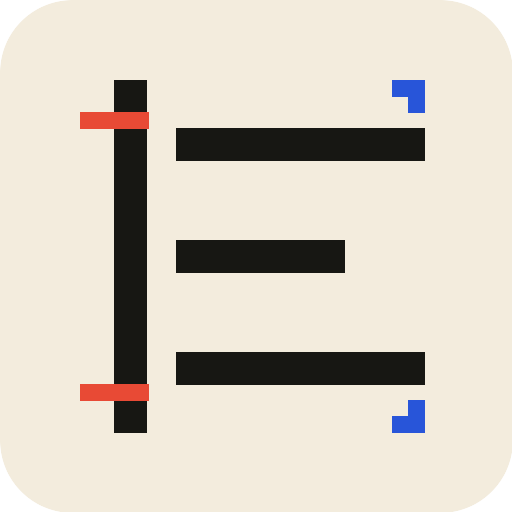

<p align="center">
  
</p>

# Set & Signal 🏋️ · Make the next set obvious

[](https://github.com/aranlucas/set-and-signal/actions/workflows/ci.yml)
[](LICENSE)

Set & Signal is a self-hostable workout planner and training log, built as a
React/Vite app embedded in a Go server. Hosted accounts use Convex for training
records and SQLite for identity and operations; guest and standalone mobile
training data stays on-device. An optional AI assistant and an OAuth-protected
MCP endpoint let assistant clients work with training data.

## Run locally

Use the Go version in `go.mod`, Node.js from `.node-version`, and pnpm from the
root `package.json`. A Convex deployment is required to start the API.

```bash
pnpm install --frozen-lockfile
```

Complete [Convex setup](docs/convex.md#configure-a-deployment) before starting
the app. It creates `web/.env.local` and the local signing key:

```bash
pnpm dev
```

Open `https://set-and-signal.localhost`. The development command sources
`web/.env.local`, stores API data in `./data`, and runs both services through
[Portless](https://github.com/vercel-labs/portless). The first run may ask for
`sudo` to bind port 443 and trust a local certificate. Vite proxies API, OAuth,
discovery, and MCP requests to `https://api.set-and-signal.localhost`, keeping
cookies and callbacks on the web origin. Passkeys registered for `localhost`
do not carry over to this hostname.

For self-hosting, use `.env.example` for common runtime settings and
`internal/config/config.go` for defaults. Set `CONVEX_URL` to the training
deployment and keep `PUBLIC_URL`, `ORIGIN`, and the passkey `RP_ID` consistent
with the public origin. See the [Railway guide](.railway/README.md) for the
existing infrastructure and data-volume precautions.

A deployment operator controls the API, Convex project, and persistent volume.
The optional OpenRouter feature sends selected prompts to that provider; review
[SECURITY.md](SECURITY.md) before exposing an instance to other users.

## Contributing and reference

- [Contributor checks](CONTRIBUTING.md)
- [Architecture boundaries](docs/architecture.md)
- [Storage and compatibility contracts](docs/data-model.md)
- [Convex setup and recovery](docs/convex.md)
- [Interface constraints](docs/design.md)
- [Translation authoring](docs/i18n.md)
- [Equipment and time planning](docs/session-planning.md)
- [Product roadmap](ROADMAP.md)

Licensed under [GNU AGPL v3 or later](LICENSE). Preserve the third-party
attributions and exercise-media restrictions in [NOTICE.md](NOTICE.md).
